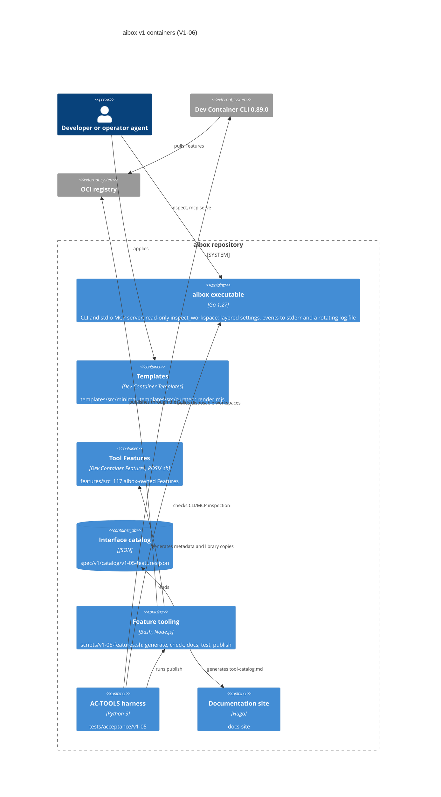
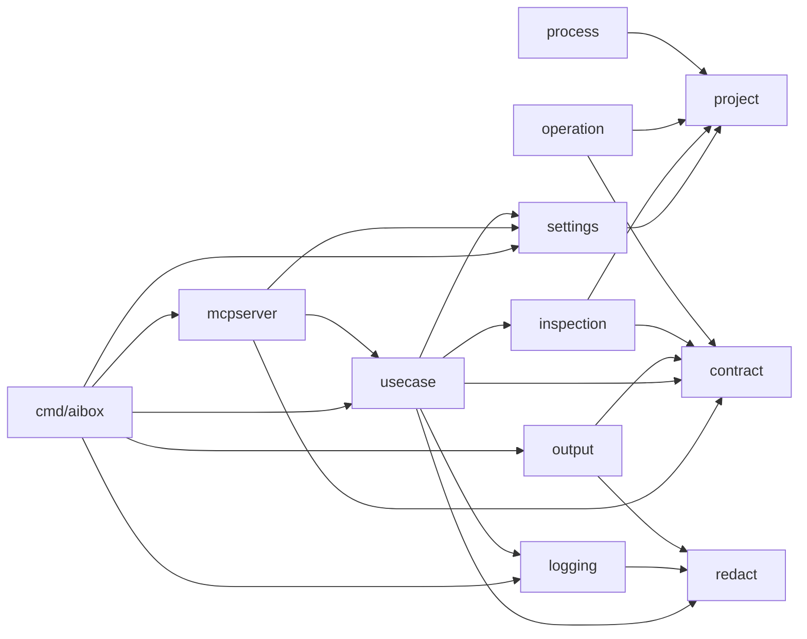

# Building blocks

aibox v1 has two kinds of building block. The **Go executable** inspects a
project and, in later phases, operates on it. The **native artifacts**,
Templates and tool Features, are standard Dev Container packages that work
without the executable. Generators and tests keep both in step with the
specification.

## C4 container view

## The Go executable

One module, `github.com/projectious-work/aibox`, builds one binary from
`cmd/aibox`. The table lists the packages that exist and the chapter 7
responsibility each one realizes.

| Package | Responsibility | Chapter 7 role |
|---|---|---|
| [`cmd/aibox`](https://github.com/projectious-work/aibox/tree/main/cmd/aibox) | Composition root: the command-line parser driven by the flag table (`cmdline.go`), settings resolution before the operation, logger and file sink start, SIGINT/SIGTERM handling, rejection output, exit code | `cmd/aibox`, and the CLI adapter (`internal/cli` does not exist yet) |
| [`internal/usecase`](https://github.com/projectious-work/aibox/tree/main/internal/usecase) | `InspectWorkspace`, shared by CLI and MCP; `Execute` with the time limit, cancellation and the required-sink rule; the effective-configuration view; request IDs. Ports: `Inspector`, `Events`, `SinkHealth` | `internal/app` |
| [`internal/settings`](https://github.com/projectious-work/aibox/tree/main/internal/settings) | The key catalog; loading of the system and user files, the project layer, environment files, the environment and the flags; precedence, authority and failure order; XDG paths and log-file confinement. Reads only, through the `FileSystem` port | `internal/config` |
| [`internal/logging`](https://github.com/projectious-work/aibox/tree/main/internal/logging) | Event model, level filter, plain and JSON Lines encoders, bounded queue, stderr sink, file sink with lock, rotation and retention | `internal/logging` |
| [`internal/redact`](https://github.com/projectious-work/aibox/tree/main/internal/redact) | Known secrets, secret shapes and the home prefix; a streaming writer for child output | Part of `internal/logging` |
| [`internal/output`](https://github.com/projectious-work/aibox/tree/main/internal/output) | Result as JSON, block YAML or a human summary; colour rule; terminal check; bootstrap diagnostic | `internal/output` |
| [`internal/mcpserver`](https://github.com/projectious-work/aibox/tree/main/internal/mcpserver) | Fixed MCP registry with the read-only `inspect_workspace` tool (`effectiveConfig` input); settings fixed at start; one event scope per call | `internal/mcp` |
| [`internal/inspection`](https://github.com/projectious-work/aibox/tree/main/internal/inspection) | Reads the native declaration and returns the inspection payload, including selected Feature references without options; stops when its context ends | Read side of `internal/project` |
| [`internal/contract`](https://github.com/projectious-work/aibox/tree/main/internal/contract) | Result envelope, `inspect_workspace` payload with `settingsSources` and `overridden`, outcomes, error codes, warnings, exit-code mapping | `internal/contract` |
| [`internal/project`](https://github.com/projectious-work/aibox/tree/main/internal/project) | Canonical project root, confined file paths, input manifest and digest | `internal/project` |
| [`internal/process`](https://github.com/projectious-work/aibox/tree/main/internal/process) | No-shell child runner with bounded, redacted output and process-group cancellation; executable resolution with byte digest | `internal/process` |
| [`internal/operation`](https://github.com/projectious-work/aibox/tree/main/internal/operation) | Exact-environment advisory lock, durable operation records, interruption classification | `internal/operation` |
| [`internal/schematest`](https://github.com/projectious-work/aibox/tree/main/internal/schematest) | Test-only checker of documents against the frozen contract schemas | Test support |

Dependencies point inwards. `cmd/aibox` composes the graph; the two adapters
call the use case; the use case returns `contract` values.

`process` and `operation` are tested foundations for lifecycle work. No use
case calls them yet, because nothing up to V1-06 starts a child process or
mutates a runtime. The remaining chapter 7 packages (`policy`, `identity`,
`devcontainer`, `runtime`, `diagnostic`, `guidance`, `migration`,
`workspace`) are **Planned** in the phases that need them, starting with
V1-08.

### Runtime view: inspect a workspace

1. `cmd/aibox` parses the command line against the flag table. A usage
   error stops here: one `settings.rejected` event, then the
   `invalid_request` envelope (with `--format json` or `yaml`) or the
   bootstrap diagnostic, exit 2. `version` and `help` read no settings.
2. `settings.Load` reads the system and user files, the environment files,
   the process environment and the flags; `Resolve` adds the project layer
   of the selected `devcontainer.json` and returns the first defect in
   failure order, or the resolved values with their sources. Nothing is
   written.
3. The logger starts with the resolved level and format; if `logging.file`
   is set, the file sink is opened first. `settings.resolved` is emitted.
4. `usecase.InspectWorkspace` emits `operation.started` and runs the
   inspection under `Execute`: a deadline from `execution.timeoutSeconds`
   (default 30 seconds) and the SIGINT/SIGTERM context.
5. `inspection` confines `.devcontainer/devcontainer.json` to the root,
   hashes it into the input manifest digest, and parses it as JSONC
   (`tailscale/hujson`) to list the `features` keys. Option values are never
   echoed. The result has `state: unknown`, because no runtime was
   consulted. With `--effective-config`, the use case appends the redacted
   settings entries and `settingsSources`.
6. The use case emits `operation.validated` (on success), `operation.cancelled`
   (on interruption) and `operation.finished`, and adds `log_sink_degraded`
   if the file sink failed. The logger flushes for at most 2 seconds.
7. `output` writes the result as human text, JSON or YAML; the exit code
   follows the result.

`mcp serve` runs steps 2 and 3 once at start (without a project), emits
`process.started` and `settings.resolved` under a process ID, and, per tool
call, adds the project layer of the called project and runs steps 4 to 6
with the call's request ID. It emits `process.finished` when stdin closes.

## Native artifacts

### Templates

[`templates/src/minimal`](https://github.com/projectious-work/aibox/tree/main/templates/src/minimal)
and
[`templates/src/curated`](https://github.com/projectious-work/aibox/tree/main/templates/src/curated)
are standard Dev Container Template sources. `templates/render.mjs` applies
one to a project with the standard option substitution and refuses to
overwrite existing configuration. The output belongs to the project. The
rendered examples under
[`examples/`](https://github.com/projectious-work/aibox/tree/main/examples)
(`minimal`, `customized`, `custom-user`, `bind-home`) are the fixtures for
schema checks, host runs and the inspection demo.

### Tool Features

The frozen interface catalog,
[`spec/v1/catalog/v1-05-features.json`](https://github.com/projectious-work/aibox/blob/main/spec/v1/catalog/v1-05-features.json),
defines 39 groups and 120 Features: 117 owned by aibox and 3 upstream
Features referenced by digest. Groups take one of three shapes:

| Shape | Groups | Features |
|---|---|---|
| `single` | 18 | One tool Feature |
| `atomic` | 3 | One Feature installs every coupled member; no member or bundle Feature |
| `semantic` | 18 | One Feature per member and an `all` bundle that only lists members in `dependsOn` |

Each aibox Feature lives in `features/src/<catalog-id>/`. Its directory holds
three kinds of file:

- `install.sh`, written by hand: the tool-specific installation.
- `devcontainer-feature.json` and `lib/catalog.sh`, generated from the
  catalog entry: metadata, options, dependencies and guard data.
- `lib/aibox-feature.sh`, a generated copy of the shared library
  [`features/lib/aibox-feature.sh`](https://github.com/projectious-work/aibox/blob/main/features/lib/aibox-feature.sh).
  Each Feature is packaged alone, so the library travels as a copy.

### Feature tooling

[`scripts/v1-05-features.sh`](https://github.com/projectious-work/aibox/blob/main/scripts/v1-05-features.sh)
fronts `scripts/v1-05-features.mjs`:

| Command | Effect |
|---|---|
| `generate` | Regenerates the generated files of every Feature from the catalog and the library. |
| `check [--complete]` | Fails when a generated file or the tool catalog page drifts. |
| `docs` | Regenerates [`docs-site/content/docs/tool-catalog.md`](../tool-catalog.md). |
| `test` | Runs the component tests in `features/test/`. |
| `publish --registry <host>/<prefix>` | Stages each Feature, rewrites aibox `dependsOn` and `installsAfter` references to that registry, and publishes through the pinned Dev Container CLI with the tags `<version>`, `<major>` and `<major>.<minor>`. |

## Tests and evidence

| Layer | Location | What it proves |
|---|---|---|
| Go unit, component and black-box tests | `internal/*/*_test.go`, `cmd/aibox/*_test.go` | Path safety, runner limits and cancellation, records, exit codes; settings precedence per key and layer pair, failure order, sinks, rotation, 16 concurrent writers, redaction, time limits and signals; CLI/MCP parity on the built binary; drift tests against the frozen settings-and-logging contract |
| Feature component tests | `features/test/*.test.mjs` | Guards, error lines, download and verification failures, metadata and publish staging, with fakes for `apt-get`, `dpkg`, `curl` and the filesystem root |
| AC-TOOLS acceptance | [`tests/acceptance/v1-05/`](https://github.com/projectious-work/aibox/tree/main/tests/acceptance/v1-05) | Every `AC-TOOLS/*` item on a real engine: publish to a local registry, build disposable workspaces from `spec/v1/fixtures/v1-05-base`, probe as the remote user and as root, then clean up |
| Phase verifiers | `scripts/verify-v1-03.sh`, `scripts/verify-v1-04.sh`, `scripts/verify-v1-04-host.sh` | Reproducible evidence for a candidate commit, stored under `evidence/v1/` |
| Specification checks | `scripts/spec/validate.mjs`, `scripts/spec/validate-v1-05-catalog.py` | Requirement, roadmap, schema, catalog and link consistency |

The AC-TOOLS runner (`runner.py`, package `actools`) plans tests from the
catalog, runs builds in parallel on Docker or Podman (by default at most
four at once), and writes
`evidence.json` and `summary.txt` per run. Items `trace`, `guards` and
`inspect` run without a container engine.
