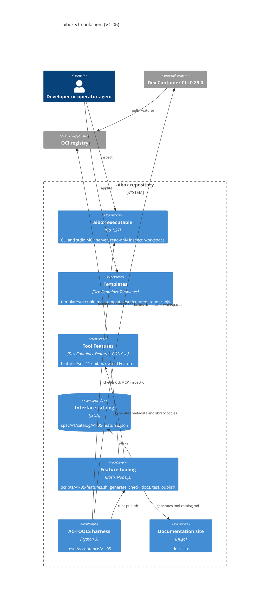

# Building blocks

aibox v1 has two kinds of building block. The **Go executable** inspects a
project and, in later phases, operates on it. The **native artifacts**,
Templates and tool Features, are standard Dev Container packages that work
without the executable. Generators and tests keep both in step with the
specification.

## C4 container view

## The Go executable

One module, `github.com/projectious-work/aibox`, builds one binary from
`cmd/aibox`. The table lists the packages that exist and the chapter 7
responsibility each one realizes.

| Package | Responsibility | Chapter 7 role |
|---|---|---|
| [`cmd/aibox`](https://github.com/projectious-work/aibox/tree/v1.x-dev/cmd/aibox) | Process entry, argument routing for `inspect`, `mcp serve`, `version` and `help`, exit code | `cmd/aibox`, and the CLI adapter (`internal/cli` does not exist yet) |
| [`internal/usecase`](https://github.com/projectious-work/aibox/tree/v1.x-dev/internal/usecase) | `InspectWorkspace`, the one use case shared by CLI and MCP; request IDs | `internal/app` |
| [`internal/mcpserver`](https://github.com/projectious-work/aibox/tree/v1.x-dev/internal/mcpserver) | Fixed MCP registry with the read-only `inspect_workspace` tool; stdio transport | `internal/mcp` |
| [`internal/inspection`](https://github.com/projectious-work/aibox/tree/v1.x-dev/internal/inspection) | Reads the native declaration and returns the inspection payload, including selected Feature references without options | Read side of `internal/project` |
| [`internal/contract`](https://github.com/projectious-work/aibox/tree/v1.x-dev/internal/contract) | Result envelope, outcomes, error codes, next actions, exit-code mapping | `internal/contract` |
| [`internal/project`](https://github.com/projectious-work/aibox/tree/v1.x-dev/internal/project) | Canonical project root, confined file paths, input manifest and digest | `internal/project` |
| [`internal/process`](https://github.com/projectious-work/aibox/tree/v1.x-dev/internal/process) | No-shell child runner with bounded, redacted output and process-group cancellation; executable resolution with byte digest | `internal/process` |
| [`internal/operation`](https://github.com/projectious-work/aibox/tree/v1.x-dev/internal/operation) | Exact-environment advisory lock, durable operation records, interruption classification | `internal/operation` |

Dependencies point inwards. `cmd/aibox` composes the graph; the two adapters
call the use case; the use case returns `contract` values.

```mermaid
flowchart LR
  main[cmd/aibox] --> usecase
  main --> mcpserver
  mcpserver --> usecase
  mcpserver --> contract
  usecase --> contract
  usecase --> inspection
  inspection --> project
  operation --> contract
  operation --> project
  process --> project
```

`process` and `operation` are tested foundations for lifecycle work. No use
case calls them yet, because nothing in V1-05 starts a child process or
mutates a runtime. The remaining chapter 7 packages (`config`, `logging`,
`policy`, `identity`, `devcontainer`, `runtime`, `diagnostic`, `guidance`,
`migration`, `workspace`, `output`) are **Planned** in the phases that need
them, starting with V1-06 and V1-08.

### Runtime view: inspect a workspace

1. The CLI parses `--project`, or the MCP server validates `requestId` and an
   absolute, canonical `projectRoot` against a closed JSON schema.
2. `usecase.InspectWorkspace` resolves the canonical root and asks
   `inspection.Workspace` for the payload.
3. `inspection` confines `.devcontainer/devcontainer.json` to the root,
   hashes it into the input manifest digest, and parses it as JSONC
   (`tailscale/hujson`) to list the `features` keys. Option values are never
   echoed.
4. The result has `state: unknown`, because no runtime was consulted.
5. Each adapter validates the envelope before it writes it. The CLI maps the
   outcome to an exit code; the MCP server sets `isError` on failure.

## Native artifacts

### Templates

[`templates/src/minimal`](https://github.com/projectious-work/aibox/tree/v1.x-dev/templates/src/minimal)
and
[`templates/src/curated`](https://github.com/projectious-work/aibox/tree/v1.x-dev/templates/src/curated)
are standard Dev Container Template sources. `templates/render.mjs` applies
one to a project with the standard option substitution and refuses to
overwrite existing configuration. The output belongs to the project. The
rendered examples under
[`spec/v1/examples/`](https://github.com/projectious-work/aibox/tree/v1.x-dev/spec/v1/examples)
(`minimal`, `customized`, `custom-user`, `bind-home`) are the fixtures for
schema checks, host runs and the inspection demo.

### Tool Features

The frozen interface catalog,
[`spec/v1/catalog/v1-05-features.json`](https://github.com/projectious-work/aibox/blob/v1.x-dev/spec/v1/catalog/v1-05-features.json),
defines 39 groups and 120 Features: 117 owned by aibox and 3 upstream
Features referenced by digest. Groups take one of three shapes:

| Shape | Groups | Features |
|---|---|---|
| `single` | 18 | One tool Feature |
| `atomic` | 3 | One Feature installs every coupled member; no member or bundle Feature |
| `semantic` | 18 | One Feature per member and an `all` bundle that only lists members in `dependsOn` |

Each aibox Feature lives in `features/src/<catalog-id>/`. Its directory holds
three kinds of file:

- `install.sh`, written by hand: the tool-specific installation.
- `devcontainer-feature.json` and `lib/catalog.sh`, generated from the
  catalog entry: metadata, options, dependencies and guard data.
- `lib/aibox-feature.sh`, a generated copy of the shared library
  [`features/lib/aibox-feature.sh`](https://github.com/projectious-work/aibox/blob/v1.x-dev/features/lib/aibox-feature.sh).
  Each Feature is packaged alone, so the library travels as a copy.

### Feature tooling

[`scripts/v1-05-features.sh`](https://github.com/projectious-work/aibox/blob/v1.x-dev/scripts/v1-05-features.sh)
fronts `scripts/v1-05-features.mjs`:

| Command | Effect |
|---|---|
| `generate` | Regenerates the generated files of every Feature from the catalog and the library. |
| `check [--complete]` | Fails when a generated file or the tool catalog page drifts. |
| `docs` | Regenerates [`docs-site/content/docs/tool-catalog.md`](../tool-catalog.md). |
| `test` | Runs the component tests in `features/test/`. |
| `publish --registry <host>/<prefix>` | Stages each Feature, rewrites aibox `dependsOn` and `installsAfter` references to that registry, and publishes through the pinned Dev Container CLI with the tags `<version>`, `<major>` and `<major>.<minor>`. |

## Tests and evidence

| Layer | Location | What it proves |
|---|---|---|
| Go unit and black-box tests | `internal/*/*_test.go`, `cmd/aibox/main_test.go` | Path safety, runner limits and cancellation, records, exit codes; CLI/MCP parity on the built binary |
| Feature component tests | `features/test/*.test.mjs` | Guards, error lines, download and verification failures, metadata and publish staging, with fakes for `apt-get`, `dpkg`, `curl` and the filesystem root |
| AC-TOOLS acceptance | [`tests/acceptance/v1-05/`](https://github.com/projectious-work/aibox/tree/v1.x-dev/tests/acceptance/v1-05) | Every `AC-TOOLS/*` item on a real engine: publish to a local registry, build disposable workspaces from `spec/v1/fixtures/v1-05-base`, probe as the remote user and as root, then clean up |
| Phase verifiers | `scripts/verify-v1-03.sh`, `scripts/verify-v1-04.sh`, `scripts/verify-v1-04-host.sh` | Reproducible evidence for a candidate commit, stored under `spec/v1/evidence/` |
| Specification checks | `spec/v1/scripts/validate.mjs`, `spec/v1/scripts/validate-v1-05-catalog.py` | Requirement, roadmap, schema, catalog and link consistency |

The AC-TOOLS runner (`runner.py`, package `actools`) plans tests from the
catalog, runs builds in parallel on Docker or Podman (by default at most
four at once), and writes
`evidence.json` and `summary.txt` per run. Items `trace`, `guards` and
`inspect` run without a container engine.
