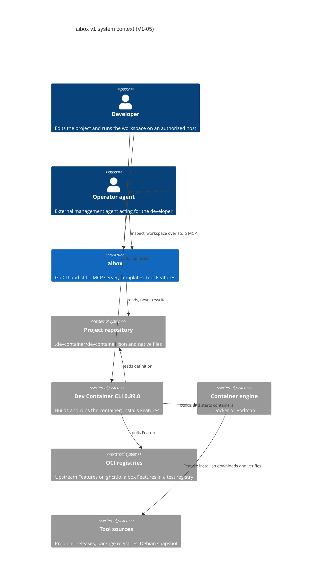

# System context

aibox sits beside the standard Dev Container toolchain, not on top of it. A
project is defined by its own `.devcontainer/` files. Users and agents can
build and run that project with the Dev Container CLI alone; aibox adds
Templates, tool Features and a typed inspection interface.

## C4 context view

The diagram shows the system at V1-05. aibox does not call the Dev Container
CLI or a container engine yet: users run `devcontainer build`, `up` and
`exec` directly, and the aibox Features are consumed by that CLI like any
other Feature. Delegating lifecycle commands through aibox is **Planned**
(V1-08).

## Actors

| Actor | Role today | Boundary |
|---|---|---|
| Developer | Applies a Template, selects Features in `devcontainer.json`, runs the Dev Container CLI, and runs `aibox inspect`. | Reviews untrusted hooks and mounts before a direct `build` or `up`; aibox cannot mediate a native tool the developer runs directly. |
| Operator agent | Calls the `inspect_workspace` MCP tool over stdio. | The only tool is read-only and closed-world. Operator policy, authorization and mutating tools are **Planned** (V1-08, V1-09). |
| Workspace agent | Works inside the container. | Gets no host socket, credential or operator endpoint. A workspace-local aibox process with refresh and diagnostics is **Planned** (V1-11, V1-16, V1-21). |

## Neighbouring systems

| System | What aibox uses | What aibox does not do |
|---|---|---|
| Project files | Reads `.devcontainer/devcontainer.json` (JSONC) for the inspection result and the input digest. | Write, merge or translate native configuration. |
| Dev Container CLI 0.89.0 | Pinned and checksummed for publishing Features and for host acceptance runs (`tools/vendor/devcontainer-cli-0.89.0.tgz`). | Reimplement its configuration merge, Feature resolution or lifecycle. |
| Container engine | Acceptance runs build disposable workspaces on Docker or Podman. | aibox itself has no engine client in V1-05. |
| OCI registries | Upstream Features are referenced by digest. aibox Features are published to a local test registry by the acceptance harness. | Publish to `ghcr.io/projectious-work/aibox-features` or the public Feature index; that is **Planned** for a release phase. |
| Tool sources | Feature installers download pinned release assets and verify checksums or signatures; Debian packages come from the base image's snapshot. | Resolve floating versions, `latest` or ranges. |

## Technical context

- **CLI:** `aibox inspect --context local --project PATH --format json`
  writes one result envelope to stdout; diagnostics go to stderr. The exit
  code follows the stable classes in
  [chapter 18](https://github.com/projectious-work/aibox/blob/v1.x-dev/spec/v1/18-operational-contracts.md).
- **MCP:** `aibox mcp serve --context local` runs a stdio server with no
  network listener. Stdout carries only the protocol.
- **Features:** standard Dev Container Feature packages (`devcontainer-feature.json`
  plus `install.sh`) consumed by any Dev Container client.
- **Templates:** standard Dev Container Template sources, applied locally by
  `templates/render.mjs` until registry publication.
